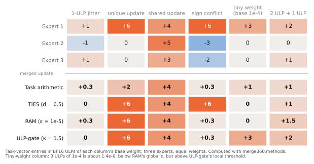
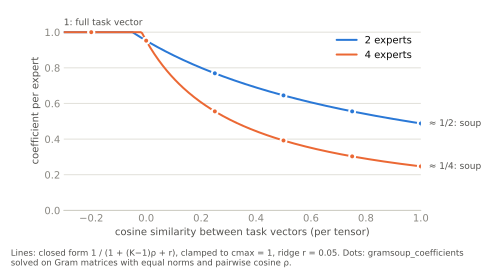
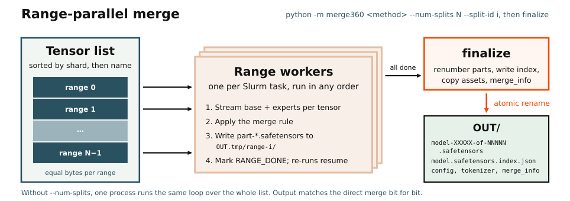

# merge360: merging RL expert checkpoints

`merge360` merges Hugging Face safetensors checkpoints that were trained from the same base, for example several RL experts (knowledge, instruction following, search, tool use), into one model. It streams one tensor at a time from every input, so memory stays at a few tensors even for a 375B MoE. It writes a sharded checkpoint with the base's config and tokenizer, can resume after interruption, and can split one merge across many Slurm tasks.

Inputs must have identical tensor names and shapes. The only requirements are `torch` and `safetensors`.

```bash
export PYTHONPATH="$PWD/src"   # the RL360 container already sets this

python -m merge360 ram \
  --base /ckpt/base \
  --experts /ckpt/knowledge /ckpt/ifbench /ckpt/search /ckpt/tool-use \
  --output /ckpt/merged-ram

python -m merge360 validate /ckpt/merged-ram --method ram+
```

Every method shares the input, output and parallel flags; `python -m merge360 <method> --help` lists them with the method's own options.

## Choosing a method

| Method | Command | What it does | Base |
| --- | --- | --- | --- |
| [Linear soup](#linear-soup) | `linear` | Weighted average of the experts. The lowest-risk baseline. | no |
| [Task arithmetic](#task-arithmetic) | `task-arithmetic` | Adds the weighted task vectors with a global scale. | yes |
| [TIES](#ties) | `ties` | Trims small updates and drops entries whose sign disagrees with the majority. | yes |
| [RAM / RAM+](#ram-and-ram) | `ram` | Averages updates that several experts share and keeps updates unique to one expert. | yes |
| [ULP-gate](#ulp-gate) | `ulpgate` | Ignores updates at BF16 rounding level, then averages the rest. | yes |
| [Gram-soup](#gram-soup) | `gramsoup` | Picks coefficients per tensor from how much the task vectors overlap. | yes |
| [ISO](#iso) | `iso` | Rotates singular vectors of selected matrices while keeping their singular values. | yes |

A practical order is linear, then task arithmetic, then RAM. Try TIES when task vectors have many sign conflicts. ULP-gate and Gram-soup are cheap to run on every tensor. ISO is the most expensive; start with the attention-only hybrid [below](#iso).

## Notation

The base is $`\theta_0`$, the $`K`$ experts are $`\theta_1, \dots, \theta_K`$, and `--weights` are normalized to $`w_k \ge 0`$, $`\sum_k w_k = 1`$ (uniform by default). Every rule is applied to one tensor at a time; $`i`$ indexes its elements.

Task vectors are measured from the base **rounded to the experts' dtype**:

```math
\bar\theta_0 = \mathrm{bf16}(\theta_0), \qquad \tau_k = \theta_k - \bar\theta_0 .
```

RL experts are usually saved in BF16 while the base may be FP32. Subtracting the FP32 base directly would turn up to half a BF16 ULP of rounding error into a fake update in every weight. All arithmetic is done in FP32 (FP64 for ISO), and the result is cast to `--output-dtype` (BF16 by default). Integer tensors must be identical in every input and are copied unchanged.

## Methods

### Linear soup

```math
\theta = \sum_{k=1}^{K} w_k\, \theta_k
```

A model soup ([Wortsman et al., 2022](#references)). It needs no base; the config and tokenizer come from the first expert. When the experts share a base this equals task arithmetic with $`\lambda = 1`$, so each expert's update is diluted by its weight.

### Task arithmetic

```math
\theta = \bar\theta_0 + \lambda \sum_{k=1}^{K} w_k\, \tau_k
```

[Ilharco et al., 2023](#references). `--scale` sets $`\lambda`$. With uniform weights, $`\lambda = K`$ adds every task vector in full and $`\lambda = 1`$ is the soup.

### TIES

[Yadav et al., 2023](#references), applied per tensor. Each expert keeps only its largest-magnitude entries (`--density` $`d`$; with $`n`$ elements, $`t_k`$ is the $`\lceil d\,n \rceil`$-th largest $`|\tau_{k,i}|`$). Then a sign is elected per element and only agreeing entries are averaged:

```math
m_{k,i} = \mathbf{1}\big[\,|\tau_{k,i}| \ge t_k\,\big], \qquad
s_i = \mathrm{sign}\Big(\sum_k w_k\, m_{k,i}\, \tau_{k,i}\Big), \qquad
a_{k,i} = m_{k,i}\, \mathbf{1}\big[\mathrm{sign}(\tau_{k,i}) = s_i \neq 0\big]
```

```math
\theta_i = \bar\theta_{0,i} + \lambda\, \frac{\sum_k w_k\, a_{k,i}\, \tau_{k,i}}{\sum_k w_k\, a_{k,i}}
\qquad (\text{0 update where no entry survives})
```

### RAM and RAM+

[Yuan et al., 2026](#references) observe that on-policy RL produces sparse task vectors, so averaging dilutes an update made by only one expert by its weight. RAM treats an expert as active at an element when it moved it by more than `--epsilon`, $`\mathcal{A}_i = \{k : |\tau_{k,i}| > \varepsilon\}`$, and

```math
u_i =
\begin{cases}
\dfrac{\sum_{k \in \mathcal{A}_i} w_k\, \tau_{k,i}}{\sum_{k \in \mathcal{A}_i} w_k} & |\mathcal{A}_i| \ge 2 \quad\text{(shared: average)}\\[2ex]
g_k\, \tau_{k,i} & \mathcal{A}_i = \{k\} \quad\text{(unique: keep)}\\[1ex]
0 & \mathcal{A}_i = \varnothing
\end{cases}
\qquad\qquad \theta_i = \bar\theta_{0,i} + \lambda\, u_i .
```

Plain RAM uses $`g_k = 1`$. RAM+ (the default, `--plus-r 0.1`) boosts the unique updates of experts that also share many entries, counting per tensor the shared entries $`S_k`$ and unique entries $`U_k`$ of expert $`k`$:

```math
g_k = 1 + r \cdot \min\!\Big(\frac{S_k}{\max(U_k, 1)},\ \alpha\Big)
```

with $`r`$ = `--plus-r` and $`\alpha`$ = `--plus-alpha`. Use `--plus-r 0` for plain RAM. Measure the distribution of $`|\tau|`$ before tuning `--epsilon`.

### ULP-gate

A heuristic developed for this repo. In the K2 375B RL experts we merged, most changed entries moved by only one or two BF16 ULPs of the base weight: rounding-level jitter rather than signal. A single global $`\varepsilon`$ cannot separate the two, because a BF16 ULP scales with the weight:

```math
\mathrm{ulp}(x) = 2^{\lfloor \log_2 |x| \rfloor - 7} .
```

ULP-gate makes the threshold local to each element. With `--k` $`\kappa`$ (1.5 by default, so moves of 2 or more ULPs survive):

```math
\mathcal{A}_i = \big\{k : |\tau_{k,i}| > \kappa\, \mathrm{ulp}(\bar\theta_{0,i})\big\}, \qquad
\theta_i = \bar\theta_{0,i} + \frac{\sum_{k \in \mathcal{A}_i} w_k\, \tau_{k,i}}{\sum_{k \in \mathcal{A}_i} w_k}
\qquad (\text{0 update if } \mathcal{A}_i = \varnothing).
```

One rule covers shared and unique entries: an update made by one expert is kept in full, like RAM. There is no sign election or magnitude trimming.

<p align="center"></p>

The per-element rules on a toy tensor, computed with `merge360.methods`: TIES trims and resolves sign conflicts, RAM keeps unique updates but uses one global threshold, and ULP-gate's threshold follows each weight's magnitude.

### Gram-soup

A heuristic developed for this repo. Gram-soup chooses one coefficient per expert and tensor so that the merged task vector keeps each expert's own component:

```math
\Big\langle \sum_j c_j\, \tau_j,\ \tau_i \Big\rangle = \lVert \tau_i \rVert^2 \quad \forall i
\qquad\Longleftrightarrow\qquad G\,c = \mathrm{diag}(G), \quad G_{jk} = \langle \tau_j, \tau_k \rangle .
```

The tensor's Gram matrix is accumulated over the flattened task vectors, then

```math
\big(G + r\, \overline{\mathrm{diag}(G)}\, I\big)\, \hat c = \mathrm{diag}(G), \qquad
c_k = K w_k \cdot \mathrm{clip}(\hat c_k,\, 0,\, c_{\max}), \qquad
\theta = \bar\theta_0 + \sum_k c_k\, \tau_k ,
```

with $`r`$ = `--ridge` (relative to the mean diagonal) and $`c_{\max}`$ = `--cmax`. The prior factor $`K w_k`$ is 1 for uniform weights. Orthogonal task vectors give $`c_k \approx 1`$, the full sum of task arithmetic; identical ones give $`c_k \approx 1/K`$, the soup. For $`K`$ task vectors of equal norm and pairwise cosine $`\rho`$, $`c = 1/(1 + (K-1)\rho + r)`$. This uses two linear passes over each tensor and no SVD.

<p align="center"></p>

### ISO

ISO is the ISO-Merger of [Zhu et al., 2026](#references) ([code](https://github.com/zhuhanqing/ISO)). It merges the singular vectors of a weight matrix and keeps its singular values: the result has the base's spectrum, so only the directions change, not the scale. It applies to 2D tensors whose name matches `--iso-pattern`; every other tensor uses `--fallback` (`ram`, `task-arithmetic` or `gramsoup`).

With the thin SVD $`\bar W_0 = U_0 \Sigma_0 V_0^\top`$ and each expert's $`W_k = U_k \Sigma_k V_k^\top`$ (columns sign-aligned to $`U_0`$), each expert's frame change is projected onto the tangent space of the orthonormal frames at $`U_0`$ and $`V_0`$:

```math
P_U(X) = X - U\, \tfrac{1}{2}\big(U^\top X + X^\top U\big), \qquad
\Delta^U_k = P_{U_0}(U_k - U_0), \qquad \Delta^V_k = P_{V_0}(V_k - V_0).
```

Only the leading `--keep` fraction of singular directions may move; the other columns of $`\Delta^U_k, \Delta^V_k`$ are zeroed. Coefficients come from the first-order effect of each expert on the matrix:

```math
E_k = \Delta^U_k \Sigma_0 V_0^\top + U_0 \Sigma_0 \big(\Delta^V_k\big)^\top, \qquad
G_{jk} = \langle E_j, E_k \rangle_F, \qquad
c = \mathrm{clip}\big((G + \epsilon I)^{-1} \mathrm{diag}(G),\ 0,\ c_{\text{clip}}\big)
```

with $`\epsilon`$ = `--iso-ridge` and $`c_{\text{clip}}`$ = `--coefficient-clip`. The combined update is retracted to orthonormal frames with the polar factor ($`\mathrm{polar}(X) = AB^\top`$ for $`X = A S B^\top`$):

```math
U = \mathrm{polar}\Big(U_0 + P_{U_0}\big(\textstyle\sum_k c_k \Delta^U_k\big)\Big), \qquad
V = \mathrm{polar}\Big(V_0 + P_{V_0}\big(\textstyle\sum_k c_k \Delta^V_k\big)\Big), \qquad
W = U \Sigma_0 V^\top .
```

`--weights` only affect the fallback. ISO needs an FP64 SVD of every selected matrix in every input (`--device cuda` moves them to the GPU; CPU SVDs follow `OMP_NUM_THREADS`), so ISO on every matrix of a large MoE is very expensive. Start with the hybrid that applies ISO to the dense paths and leaves the routed experts to the fallback:

```bash
python -m merge360 iso \
  --base /ckpt/base --experts /ckpt/knowledge /ckpt/ifbench /ckpt/search /ckpt/tool-use \
  --iso-pattern 'self_attn|shared_experts' --fallback gramsoup \
  --device cuda --output /ckpt/merged-iso
```

Routed-expert task vectors are close to orthogonal, which suits the Gram-soup fallback.

## Running large merges

**Output.** The merge is written to `<output>.tmp` and renamed to `<output>` only when complete. It contains `model-XXXXX-of-NNNNN.safetensors` shards (`--max-shard-size`, 5GiB by default), the index, every non-weight file from the base (or the first expert for `linear`), and `merge_info.json` with the method, its settings and the inputs. An existing output is never replaced unless you pass `--force`. `--dry-run` checks that the inputs match and prints the plan.

**Resume.** `--resume` continues a `<output>.tmp` after checking that its `merge_progress.json` matches the current command and that every finished part holds the expected tensors, shapes and dtypes. A part truncated by an interrupted write is set aside and recomputed, and an interrupted final rename is completed. Partial directories written before progress manifests existed need `--resume-legacy` as well.

**Range-parallel.** A single process is I/O-bound: one 375B merge took about 24 hours on one node in our runs. `--num-splits N --split-id i` runs one of N workers, each on a contiguous slice of the tensor list with about the same number of bytes. `finalize` then joins them into the same checkpoint the single-process merge writes, bit for bit. A 16-way merge of a 375B model took under an hour; a 2-node, 16-worker ISO hybrid took about 5 hours.

<p align="center"></p>

With a Slurm array:

```bash
#!/bin/bash
#SBATCH --array=0-15
#SBATCH --cpus-per-task=16
#SBATCH --mem=256G
python -m merge360 ulpgate \
  --base /ckpt/base --experts /ckpt/knowledge /ckpt/ifbench /ckpt/search /ckpt/tool-use \
  --output /ckpt/merged-ulpgate \
  --num-splits 16 --split-id "$SLURM_ARRAY_TASK_ID"
```

```bash
# After every array task succeeds, e.g. sbatch --dependency=afterok:<array-job-id>
python -m merge360 finalize --output /ckpt/merged-ulpgate
```

Workers can run in any order. Re-running a split resumes it, and a split started with different settings is rejected. `--fetch-threads` (4 by default) bounds how many inputs each worker reads at once; keep the total across workers modest on a shared filesystem.

**Validate.** `validate` reads every tensor and checks the index, shard set, total size and floating-point dtype. `--expect KEY=VALUE` checks a `merge_info.json` field:

```bash
python -m merge360 validate /ckpt/merged-ram --method ram+ \
  --expect 'weights=[0.25,0.25,0.25,0.25]' --expect epsilon=1e-5
```

## References

- Wortsman et al. *Model soups: averaging weights of multiple fine-tuned models improves accuracy without increasing inference time.* ICML 2022. [arXiv:2203.05482](https://arxiv.org/abs/2203.05482)
- Ilharco et al. *Editing Models with Task Arithmetic.* ICLR 2023. [arXiv:2212.04089](https://arxiv.org/abs/2212.04089)
- Yadav et al. *TIES-Merging: Resolving Interference When Merging Models.* NeurIPS 2023. [arXiv:2306.01708](https://arxiv.org/abs/2306.01708)
- Yuan et al. *Behavior Knowledge Merge in Reinforced Agentic Models.* ACL 2026. [arXiv:2601.13572](https://arxiv.org/abs/2601.13572)
- Zhu et al. *ISO: An RLVR-Native Optimization Stack.* arXiv preprint, 2026. [arXiv:2607.19331](https://arxiv.org/abs/2607.19331)

ULP-gate and Gram-soup are heuristics developed for this repo and have no separate reference.

<details>
<summary>BibTeX</summary>

```bibtex
@inproceedings{wortsman2022modelsoups,
  title     = {Model soups: averaging weights of multiple fine-tuned models improves accuracy without increasing inference time},
  author    = {Wortsman, Mitchell and Ilharco, Gabriel and Gadre, Samir Yitzhak and Roelofs, Rebecca and Gontijo-Lopes, Raphael and Morcos, Ari S. and Namkoong, Hongseok and Farhadi, Ali and Carmon, Yair and Kornblith, Simon and Schmidt, Ludwig},
  booktitle = {Proceedings of the 39th International Conference on Machine Learning},
  series    = {Proceedings of Machine Learning Research},
  volume    = {162},
  pages     = {23965--23998},
  year      = {2022},
  publisher = {PMLR},
  eprint    = {2203.05482},
  archivePrefix = {arXiv},
  url       = {https://proceedings.mlr.press/v162/wortsman22a.html}
}

@inproceedings{ilharco2023editing,
  title     = {Editing Models with Task Arithmetic},
  author    = {Ilharco, Gabriel and Ribeiro, Marco Tulio and Wortsman, Mitchell and Schmidt, Ludwig and Hajishirzi, Hannaneh and Farhadi, Ali},
  booktitle = {The Eleventh International Conference on Learning Representations},
  year      = {2023},
  eprint    = {2212.04089},
  archivePrefix = {arXiv},
  url       = {https://openreview.net/forum?id=6t0Kwf8-jrj}
}

@inproceedings{yadav2023ties,
  title     = {{TIES-Merging}: Resolving Interference When Merging Models},
  author    = {Yadav, Prateek and Tam, Derek and Choshen, Leshem and Raffel, Colin and Bansal, Mohit},
  booktitle = {Advances in Neural Information Processing Systems},
  volume    = {36},
  year      = {2023},
  eprint    = {2306.01708},
  archivePrefix = {arXiv},
  url       = {https://proceedings.neurips.cc/paper_files/paper/2023/hash/1644c9af28ab7916874f6fd6228a9bcf-Abstract-Conference.html}
}

@inproceedings{yuan-etal-2026-behavior,
  title     = {Behavior Knowledge Merge in Reinforced Agentic Models},
  author    = {Yuan, Xiangchi and Shi, Dachuan and Zhang, Chunhui and Liu, Zheyuan and Yao, Shenglong and Vosoughi, Soroush and Lee, Wenke},
  booktitle = {Proceedings of the 64th Annual Meeting of the {A}ssociation for {C}omputational {L}inguistics (Volume 1: Long Papers)},
  month     = jul,
  year      = {2026},
  address   = {San Diego, California, United States},
  publisher = {Association for Computational Linguistics},
  pages     = {33007--33028},
  doi       = {10.18653/v1/2026.acl-long.1524},
  url       = {https://aclanthology.org/2026.acl-long.1524/},
  eprint    = {2601.13572},
  archivePrefix = {arXiv}
}

@misc{zhu2026iso,
  title         = {{ISO}: An {RLVR}-Native Optimization Stack},
  author        = {Zhu, Hanqing and Cong, Wenyan and Sha, Zhizhou and Mukherjee, Sagnik and Song, Xinyuan and Gonz{\'a}lez-Mart{\'i}nez, David and Wu, Xiaoxia and Tian, Yuandong and Liu, Shiwei and Pan, David Z. and Wang, Zhangyang},
  year          = {2026},
  eprint        = {2607.19331},
  archivePrefix = {arXiv},
  primaryClass  = {cs.LG},
  url           = {https://arxiv.org/abs/2607.19331}
}
```

</details>
